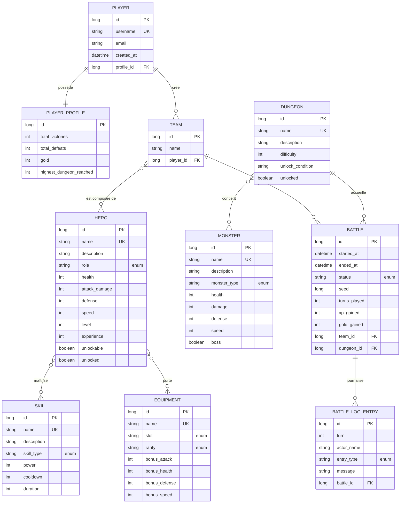
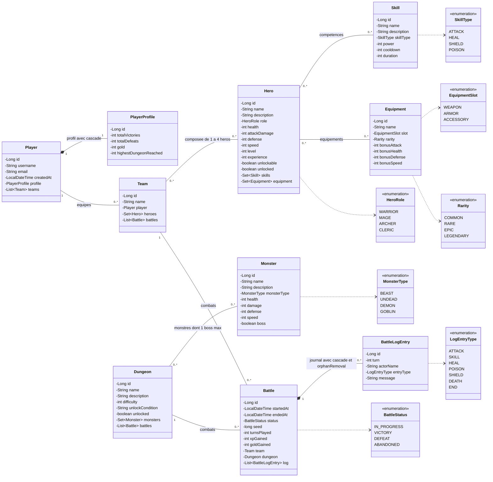
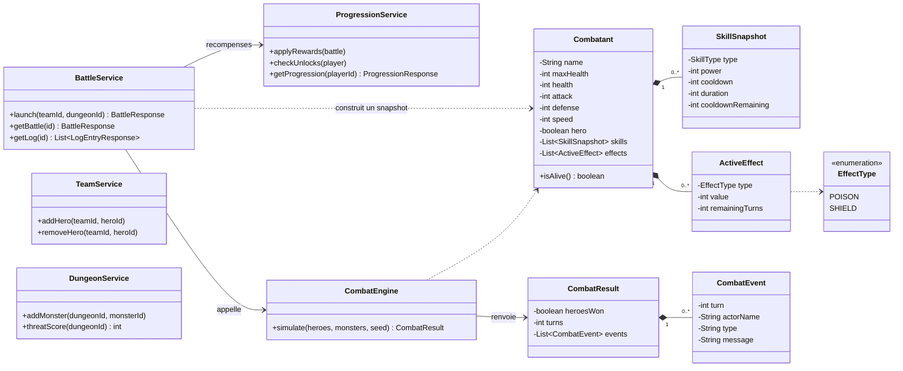

# Diagrammes du projet

Référence de l'équipe pour le modèle de données et l'architecture du moteur de combat.

## 1. MCD (modèle entité-association)

Les relations N-N sont dessinées directement, sans les tables de jointure
(`team_hero`, `hero_skill`, `hero_equipment`, `dungeon_monster`), générées par JPA.

## 2. Diagramme de classes : entités

Côté propriétaire des relations N-N (`@JoinTable`) : `Team` (heroes), `Hero` (skills, equipment), `Dungeon` (monsters).

## 3. Diagramme de classes : services et moteur de combat

Le moteur (`combat/`) est du Java pur, sans Spring ni JPA.

